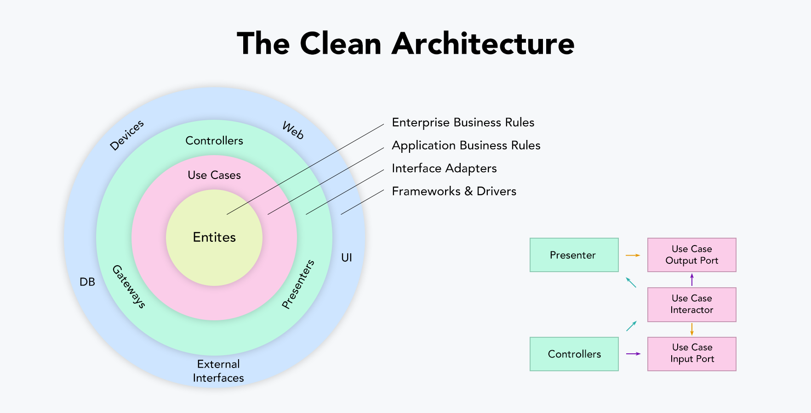
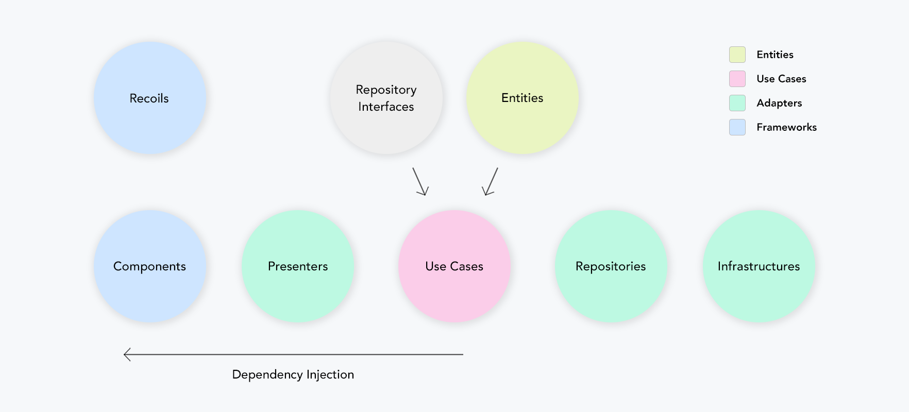
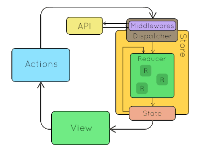

# sale_web
A web for sale to manage Travel Office system

# Prerequisites
1. NodeJS 12+
2. IDE (VS Code / WebStorm)

# Architecture overview
### 1. Clean architecture
#### Architecture

As with various architectures, the primary purpose of a clean architecture is to separate concerns. Divide the hierarchy according to each interest, design domain-centric rather than detailed implementation, and make sure that the internal area does not depend on external elements such as the framework or database UI.

Distinguish between detailed implementation areas and domain areas.
Architecture does not depend on the framework.
The outer zone can depend on the inner zone, but the inner zone cannot depend on the outer zone.
Both high-level and low-level modules rely on abstraction..
#### Communitaction Flow

Ref: https://github.com/falsy/react-with-clean-architecture
### 2. Redux

# Project structure
    .
    ├── build                       # Compiled files
    ├── infrastructures             # Configuaration for infrastructures and CI/CD
    ├── src                         # Source files
    │   ├── adapters                # Adapters layer that convert data from the format most convenient for the use cases and entities, to the format most convenient for some external agency such as the Database or the Web.
    │   │   ├── infrastructures     # Includes providers which consume platform APIs
    │   │   ├── presenters          # Includes presenters which consume use cases to perform operations
    │   │   └── repositories        # Includes repository which consume providers and transform data
    │   │── assets                  # Includes scss, images, json,...
    │   │── components              # Includes common components
    │   │── config                  # Includes common configurations for app
    │   │── domains
    │   │   ├── entities            # Includes entity definitions
    │   │   ├── mappers             # Converters between entities
    │   │   └── useCases            # Includes application specific business rules. 
    │   │── features                # Includes features of the App, such as Dashboard, Chat, Lead,...
    │   │── graphql                 # Includes definition of GraphQL query, mutation, subscription 
    │   │── hooks                   # Custom hooks used in app
    │   │── navigation              # Definition of sidebar menu
    │   │── redux
    │   │   ├── saga                # Includes redux-saga definitions
    │   │   ├── slices              # Includes definitions of redux (followed redux-toolkit)
    │   │   ├── rootSaga            # Root saga where registers sagas
    │   │   └── store               # Root of redux
    │   │── themes                  # Theme configuration
    │   │── utils                   # Utility functions
    │   │── index.tsx               # Root of app
    │   └── ...
    └── README.md
# Run and build app locally
Before running app, make sure .env.development is configured as correct values.
1. Install dependencies
```shell
npm ci
```
2. Run app
```shell
npm run start
```
3. To solve lint errors
```shell
npm run lint:fix
```

# Wiki
https://github.com/TravelOffice/web_wiki/wiki

# Technical stacks
**Languages:** Typescript, CSS <br>
**Framework:** ReactJS 17, redux, redux-saga <br>
**CSS Framework:** Bootstrap (wrapped by Reactstrap library)

# Scripts
1. Install CLI
```shell
npm install -g toweb
```
3. Generate CRUD use cases
```shell
toweb generate --model <model_name>
```
